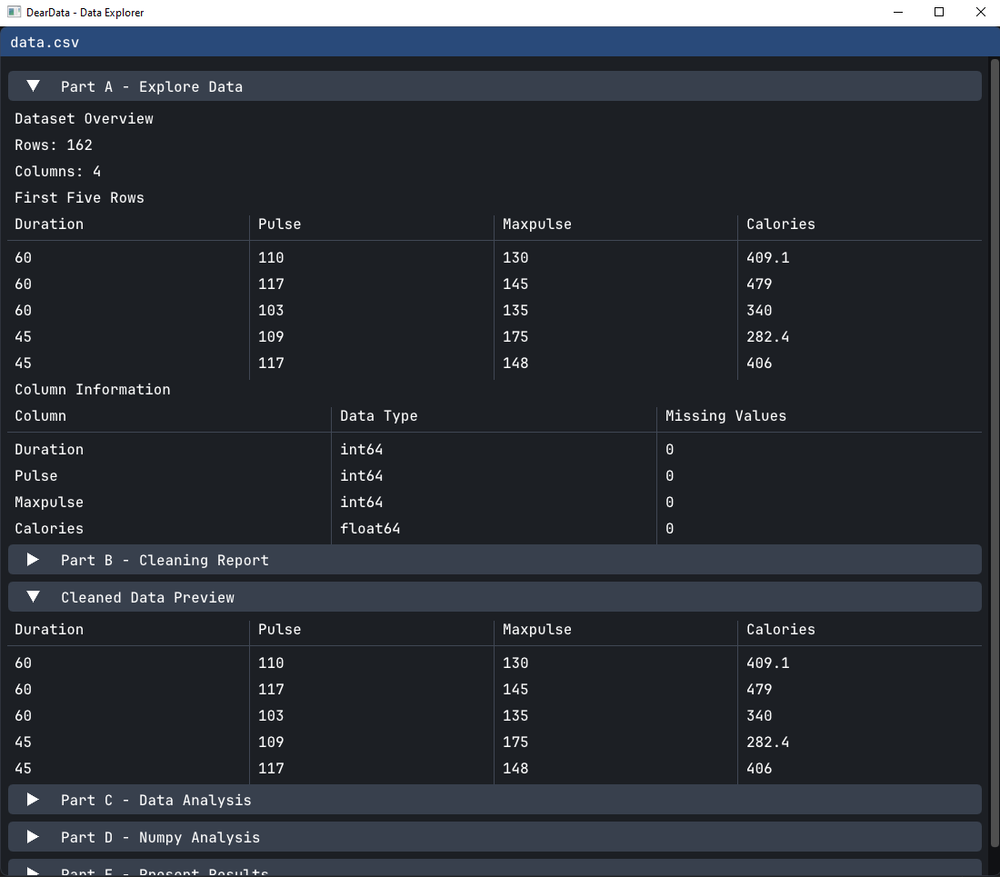
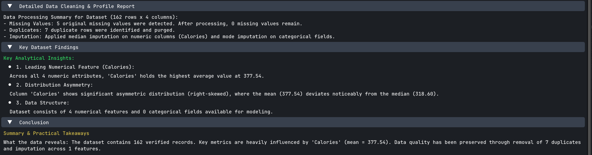

<p align="center">
    
</p>

<p align="center">
    
</p>


# Data Cleaning & Analytics GUI

A Python desktop application that provides an interactive GUI for loading, cleaning, and analyzing tabular datasets
using pandas, with results rendered via OpenGL/ImGui.

Overview

This tool combines:

- `pandas` for data manipulation and analysis
- Dear ImGui (via `imgui` + `pyimgui`) for a lightweight, immediate-mode GUI
- `GLFW` + `PyOpenGL` for windowing and rendering

It is designed to walk a dataset through a cleaning pipeline (handling missing values, removing duplicates, type
conversion/imputation) and then produce an executive summary with key metrics and a narrative report.

## Requirements

- Python 3.12.x (later only if `pyimgui` devs fix for later versions)
- A working OpenGL context / graphics drivers
- System dependencies for GLFW (e.g., `libglfw3` on Linux, Xcode command line tools on macOS)

## Installation

[uv](https://github.com/astral-sh/uv) is a fast Python package and environment manager.

1. Install uv (if not already installed):

```shell
# Windows (PowerShell)
powershell -c "irm https://astral.sh/uv/install.ps1 | iex"

# or via pip
pip install uv
```

2. Clone the repository and create a virtual environment:

```shell
git clone <repo-url> data-cleaning-gui
cd data-cleaning-gui

uv venv --python 3.12
```

This creates a .venv/ directory using Python 3.12.

3. Activate the environment:

```shell
# macOS / Linux
source .venv/bin/activate

# Windows (PowerShell)
.venv\Scripts\Activate.ps1

# Windows (cmd)
.venv\Scripts\activate.bat
```

4. Install dependencies from requirements.txt:

```shell
uv pip install -r requirements.txt
```

## Usage

```shell
python deardata.py # loads data.cs, use:
python deardata.py flowers.csv # to specify
```

The application opens an ImGui window. Use it to run the cleaning pipeline and inspect the CleaningReport and View the
generated ExecutiveSummary metrics and report text.

## Notes

Supplied datasets:

- flowers.csv - https://huggingface.co/datasets/scikit-learn/iris
- data.csv - dataset that was provided with lab1 examples
